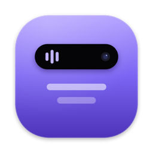
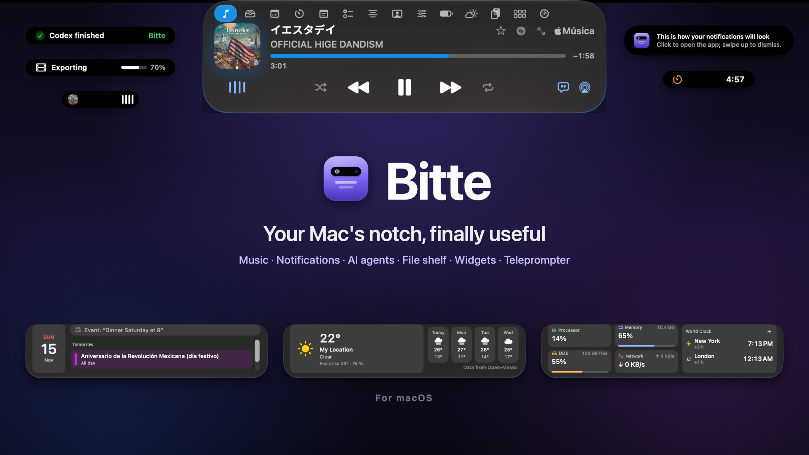
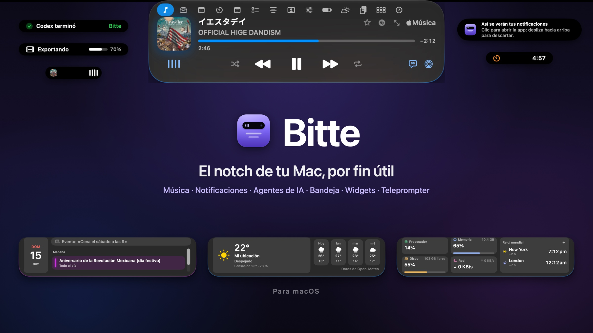

  

<h1 align="center">Bitte</h1>

  <b>Your Mac's notch, finally useful.</b> 
  No notch? You get a Dynamic Island–style floating island instead.

  <a href="https://github.com/rafaelo96/Bitte-releases/releases/latest"><b>⬇︎ Download the latest version</b></a>
  · macOS 14.6+ · Apple Silicon & Intel · Free beta

  

**[Español más abajo ↓](#español)**

## What it does

Bitte lives at the top of your screen and keeps the things you check all day one hover away.

- **Mac with a notch:** the notch grows when something's happening and opens when you hover over it.
- **Mac without a notch** (Mac mini, iMac, older MacBooks or external monitors): a floating island at the top with the same features, or a simulated notch if you prefer. It works on several screens.

**Features**

- 🎵 **Music:** artwork, visualizer, controls and synced lyrics (optional)
- 🔔 **Notifications** in Dynamic Island style
- 🤖 **AI coding agents** (Codex, OpenCode and more) tell you when they finish or need your permission
- 📂 **File shelf:** drop files on it and drag them out anywhere, with Quick Look and AirDrop
- 📅 **Widgets:** calendar with a "Join" button for meetings, timer, weather, system stats, quick controls and a launcher
- 🎤 **Teleprompter** that scrolls your script right under the camera
- 🎧 AirPods battery, volume and brightness HUD, clipboard, camera mirror, Shazam and more
- 🌐 English and Spanish

It's built to stay light and out of your way: privacy-sensitive features are off by default, and it hides when an app goes full screen.

## Install

1. Download **`Bitte-x.y.z-beta.dmg`** from the [latest release](https://github.com/rafaelo96/Bitte-releases/releases/latest).
2. Open it and drag **Bitte** into **Applications**.
3. Open Bitte. It isn't notarized by Apple yet, so macOS will say it can't verify the developer. Go to **System Settings → Privacy & Security**, scroll down to the Bitte notice and click **Open Anyway**.
    Or in Terminal: `xattr -dr com.apple.quarantine /Applications/Bitte.app`
4. Follow the welcome screen: pick your modules and grant only the permissions you want.

## Feedback

Bitte is a beta and your feedback helps a lot. Please [open an issue](https://github.com/rafaelo96/Bitte-releases/issues) with what happened. In Bitte, **Settings → About → "Copy Info and Send Feedback"** copies your version, macOS and Mac model so you can paste them in.

---

## Español

  

**El notch de tu Mac, por fin útil.** ¿Tu Mac no tiene notch? Tienes una isla flotante al estilo Dynamic Island.

Bitte vive arriba de la pantalla y te deja a mano lo que consultas todo el día.

- **Mac con notch:** el notch crece cuando pasa algo y se abre al pasar el ratón.
- **Mac sin notch** (Mac mini, iMac, MacBooks anteriores o monitores externos): una isla flotante arriba con las mismas funciones, o un notch simulado si lo prefieres. Funciona en varias pantallas.

**Funciones**

- 🎵 **Música:** portada, ecualizador, controles y letra sincronizada (opcional)
- 🔔 **Notificaciones** al estilo Dynamic Island
- 🤖 **Agentes de IA** (Codex, OpenCode y más) que te avisan cuando terminan o necesitan tu permiso
- 📂 **Bandeja de archivos:** suéltalos y sácalos arrastrando, con vista rápida y AirDrop
- 📅 **Widgets:** calendario con botón para unirte a reuniones, temporizador, clima, sistema, controles rápidos y lanzador
- 🎤 **Teleprompter** que sube tu guion justo bajo la cámara
- 🎧 Batería de los AirPods, HUD de volumen y brillo, portapapeles, espejo, Shazam y más
- 🌐 Español e inglés

Está hecha para ser ligera y no estorbar: lo que toca tu privacidad viene apagado y se oculta cuando una app está a pantalla completa.

### Instalar

1. Descarga **`Bitte-x.y.z-beta.dmg`** de la [última versión](https://github.com/rafaelo96/Bitte-releases/releases/latest).
2. Ábrelo y arrastra **Bitte** a **Aplicaciones**.
3. Abre Bitte. Como aún no está notarizada por Apple, macOS dirá que no puede comprobar el desarrollador. Ve a **Ajustes del Sistema → Privacidad y seguridad**, baja hasta el aviso de Bitte y pulsa **Abrir igualmente**.
    O en Terminal: `xattr -dr com.apple.quarantine /Applications/Bitte.app`
4. Sigue la bienvenida: elige módulos y concede solo los permisos que quieras.

Requiere macOS 14.6 o posterior, en Apple Silicon o Intel.

### Comentarios

Es una beta y tus comentarios ayudan mucho. [Abre un issue](https://github.com/rafaelo96/Bitte-releases/issues) contando lo que pasó. En Bitte, **Ajustes → Acerca de → "Copiar datos y enviar comentarios"** copia tu versión, macOS y modelo de Mac para que los pegues.
